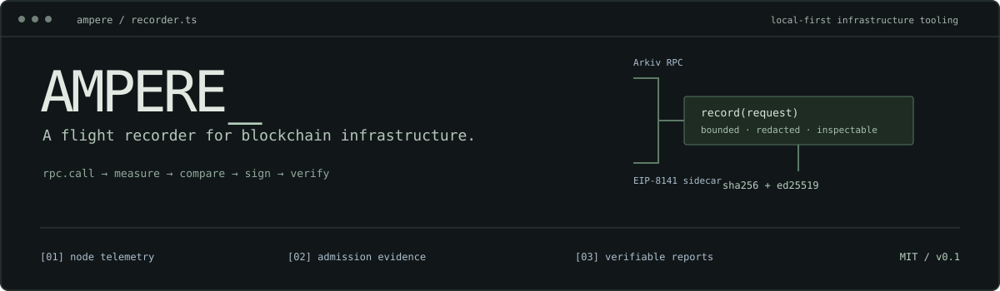
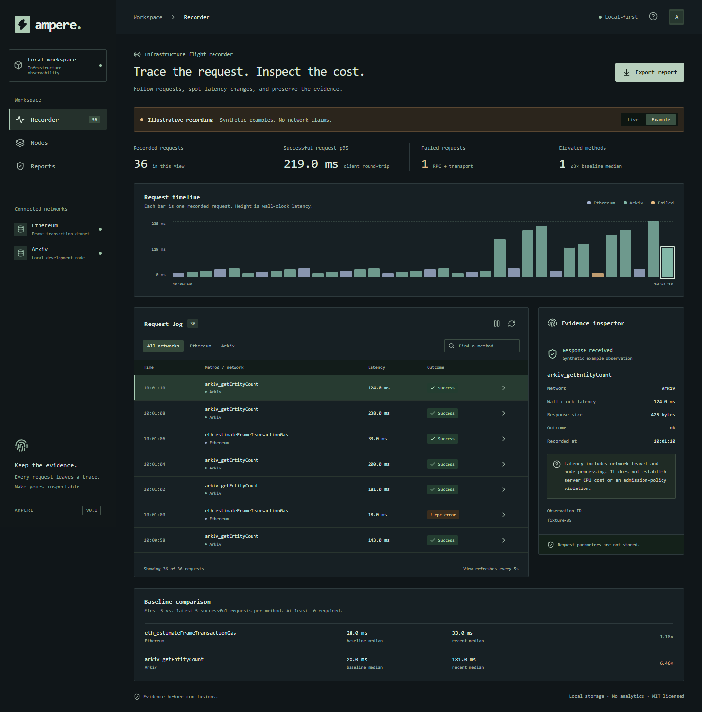

<p align="center">
  
</p>

<p align="center">
  <a href="#boot">Boot</a> ·
  <a href="#instrumentation">Instrumentation</a> ·
  <a href="#protocol-paths">Protocol paths</a> ·
  <a href="docs/REQUIREMENTS.md">Track audit</a> ·
  <a href="docs/DEMO.md">Demo runbook</a> ·
  <a href="LICENSE">MIT</a>
</p>

**Trace the request. Inspect the cost. Preserve the evidence.**

AMPERE runs beside a blockchain node. It records bounded JSON-RPC exchanges,
compares method latency, reads container resource counters, and signs portable
incident records. Built in TypeScript with a local Next.js console.

```text
interfaces   Arkiv JSON-RPC / Docker stats / EIP-8141 sidecar
evidence     wall-clock latency / rule verdicts / node resource snapshots
integrity    canonical JSON → SHA-256 → Ed25519
storage      local files / 1,000 retained observations / no hosted backend
```

> **Build status:** the local Arkiv flow is exercised: 24 entities written and
> read back; a 20-request bounded benchmark completed. Ethereum submission code
> is implemented; live admission awaits workshop-devnet funding. Public repository
> publication and the final demo are still pending. [Evidence and limits](docs/VALIDATION.md)

## Boot

Requires **Node ≥22.16**, npm, and Docker with a running Linux engine.
Tested on Windows PowerShell with Docker Desktop. Google Chrome is only required
for browser tests. No public Arkiv funds are needed.

```sh
npm ci
docker compose up -d
npm run doctor
npm run collect
npm run dev
```

Open **http://127.0.0.1:3000**. In a second terminal:

```sh
npm run collect:watch
```

The collector samples, then waits ten seconds. The console refreshes the saved
snapshot every five seconds. The console alone does not collect data. Optional
settings are in [`.env.example`](.env.example).

`doctor` checks Docker, the owned node, the devnet connection, saved recording and
writer lock without sending transactions or requesting funds. For a production
console, run `npm run build` followed by `npm start` instead of `npm run dev`.

<p align="center">
  
  <br /><sub>Example mode: deliberately synthetic data, visibly labeled. No live incident or slow-query discovery is claimed by this preview.</sub>
</p>

## Instrumentation

**Hosting on Netlify:** keep Docker and the collector on your machine; publish
signed snapshots to the hosted console over HTTPS. The integration is implemented.
Follow the [Netlify deployment guide](docs/NETLIFY.md) for the five runtime variables
and collector settings. No public node port or inbound tunnel is needed.

| Surface                    | What AMPERE records                                                       | Operator use                                                  |
| :------------------------- | :------------------------------------------------------------------------ | :------------------------------------------------------------ |
| RPC method counters        | Observed requests, failures, successful-call p50 / p95                    | Identify which monitored methods need investigation           |
| Request timeline           | Duration, method, network, response bytes, outcome                        | Inspect a specific exchange instead of an aggregate alone     |
| Node status                | Client, chain, block, peers, sync                                         | Distinguish node state from transport failures                |
| Container telemetry        | CPU, memory, processes, block I/O, `/data` size                           | See resources unavailable to an external node directory       |
| Capacity forecast          | Days until shared filesystem capacity is consumed at observed node growth | Alert below seven days; show unknown until sufficient history |
| Private workload benchmark | Bounded samples with separate baselines and block metadata                | Reproduce a measurement without publishing query text         |
| Admission evidence         | Sidecar rule verdicts and transaction lifecycle                           | Explain the experimental mempool's reported decision          |
| Signed report              | Complete retained recording, digest, signature, public key                | Detect changes after export                                   |

**Scope matters.** RPC counters cover AMPERE probes and benchmarks, not traffic
from every client of the node. Latency includes network travel; it is not server
CPU time. Container counters are aggregate. Disk capacity is shared with other
writers, and its linear forecast needs at least 60 seconds of observed growth.

## Protocol paths

### Arkiv / owned-node diagnostics

Stop the watch collector before running another recording writer:

```sh
npm run arkiv:seed       # create 24 entities; require logs + read-back
npm run arkiv:benchmark  # 2 benign workloads × 10 sequential samples
npm run collect:watch    # resume node telemetry
```

| Node identity   | Value                                                                               |
| :-------------- | :---------------------------------------------------------------------------------- |
| Client          | `arkiv-reth --dev`, reports `reth/v2.7.0-d32fbaf`                                   |
| RPC             | `http://127.0.0.1:8545`                                                             |
| Chain           | `1337`, local development chain                                                     |
| Image           | `ghcr.io/arkiv-network/arkiv-reth` pinned by digest in [compose.yaml](compose.yaml) |
| Seed writer     | `0xf39Fd6e51aad88F6F4ce6aB8827279cffFb92266` — public development account           |
| Write interface | `execute(Operation[])` at `0x4400000000000000000000000000000000000044`              |
| Entity contract | [Schema, indexed fields, owner and expiry](arkiv/schema.md)                         |

The seed writes through the pinned node ABI using viem; it verifies all 24 entities.
The SDK/node mismatch that led to this choice is documented in
[Arkiv feedback](arkiv/friction.md). Node and Ethereum devnet share chain ID 1337
but are separate networks and endpoints.

Benchmark queries run **only on an owned loopback node**. A run allows at most four
workloads, ten samples each, page limits ≤10, concurrency 1, a 2s timeout, and stops
on the first failure or latency >1s. Default reads follow the head; each sample
records its returned block. `npm run arkiv:benchmark:fixed` exercises fixed-block
reads and the documented retention failure path.

**Disclosure boundary:** query text and workload mappings remain under ignored
`.ampere/`. Reports expose opaque workload IDs, not query text or hashes. Any
discovered slow-query shape goes privately to Arkiv through its booth process;
never into this repository, the feedback document, screenshots, or a public demo.

### Ethereum / frame-transaction admission

```text
chain guard → disposable devnet key → balance check
           → sign [VERIFY, SENDER] → eth_sendFrameTransaction
           → receipt → skandha_explorer_getTransaction → rule evidence
```

```sh
npm run ethereum:send
npm run ethereum:inspect
```

Funding is explicit: `ethereum:send` stops with the account address if its balance
is insufficient. To opt into a faucet request, use `npm run ethereum:send:faucet`.
The sender saves the computed hash before submission, including rejected or
ambiguous attempts. `ethereum:inspect` refreshes both receipt and admission
history; expired sidecar history does not discard a mined receipt. An unresolved
submission must be inspected before another send to avoid accidental duplicates.

Uses `@forshtat/hegota-support` and the workshop's experimental profile. The
transaction is a zero-value self-transfer. The first milestone proves the normal
submission path; it does not demonstrate an alt-only transaction shape or a new
DoS vector. [Sender](scripts/send-frame.ts) · [Inspector](scripts/inspect-frame.ts)

Gateway: `https://altmempoolgateway.forshtat.com/rpc`, workshop chain **1337**.
The faucet returned `The faucet is empty` during the initial run. Funding is
deferred; no admitted AMPERE transaction is claimed. The disposable sender is
`0x0c99FE76869e0e86E4d43A72cC244aA09f2B9910`. After funding on that devnet,
run the commands above and search the resulting hash in the
[devnet explorer](https://explorer.altmempool.wtf/).

## Evidence format

```text
Observation {
  network, method, source, recordedAt,
  durationMs, responseBytes, outcome,
  rpcCode?, workloadId?, blockNumber?
}

SignedReport {
  payload: { schema, createdAt, recording, limitations },
  sha256, signature, publicKey
}
```

Export from **Reports**, then verify in the console or independently:

```sh
npm run verify -- path/to/report.json
```

The signature covers canonical payload bytes. Export includes the latest complete
saved snapshot, not just filtered rows. An embedded public key establishes
integrity and key possession, not a trusted identity, true measurements, or a
blockchain timestamp. [Implementation](src/lib/report.ts)

## Source map

```text
src/lib/rpc.ts          bounded, measured RPC; params never recorded
src/lib/collector.ts    chain reads + host sampling
src/lib/container.ts    Docker counters + node data growth
src/lib/analysis.ts     method distributions / baseline / capacity alert
src/lib/admission.ts    selected rule and lifecycle metadata
src/lib/report.ts       canonicalization / hashing / signing / verification
src/lib/recording-schema.ts  runtime validation and allowed evidence fields
src/lib/writer.ts       exclusive writer / failure cleanup
scripts/               doctor, seed, benchmark, collect, send, inspect, verify
src/components/        recorder console + diagnostics
arkiv/                 four judging criteria + entity schema
```

## Validate

```sh
npm run check          # typecheck + tests + production build/privacy check
npm run test:e2e
```

Tests cover real loopback HTTP failures and timeouts, response bounds, query
baseline isolation, signature tampering, capacity alerts, method counters, and
desktop/mobile console flows. Six browser/API tests also cover paused polling,
stale node state, repeated source selection, malformed data and bounded uploads.
The Ethereum CLI tests use a local mock, not funded devnet transactions.
[Validation record](docs/VALIDATION.md)

[CI](.github/workflows/check.yml) runs the checks and production browser tests on
push/PR once the repository is published. Locally, browser tests use Chrome;
CI installs Playwright Chromium. The workflow has not run on GitHub yet.

Netlify transport tests use the official Blobs SDK's local server. Actual hosted
deployment is still pending; local tests are not a claim that a public site exists.

## Submission map

**Arkiv Node tooling** is the primary operator-tooling target. **EF Frame
Transaction Alternative Mempool** is the admission-tooling target.

| Review document                            | Contents                                                   |
| :----------------------------------------- | :--------------------------------------------------------- |
| [Track requirements](docs/REQUIREMENTS.md) | Requirement → implementation → evidence → outstanding work |
| [Arkiv feedback](arkiv/friction.md)        | Expected / observed behavior and reproduction              |
| [Real use](arkiv/real-use.md)              | Operator decisions supported by the measurements           |
| [What's new](arkiv/whats-new.md)           | Contribution beyond existing node tools                    |
| [Easy to run](arkiv/easy-to-run.md)        | Setup, prerequisites and failure recovery                  |
| [Demo sequence](docs/DEMO.md)              | Live demonstration and honest fallback paths               |
| [Operator runbook](docs/RUNBOOK.md)        | Detailed setup, configuration and troubleshooting          |

Only one Arkiv track prize can be won per team. We are targeting Node tooling;
there is no claimed Swarm bonus integration. Prize eligibility remains the
organizers' decision. [Official tracks](https://ethglobal.com/events/mumbai/prizes)

## Failure recovery

| Symptom                  | Next step                                                                         |
| :----------------------- | :-------------------------------------------------------------------------------- |
| Node unavailable         | `docker compose ps`; `docker compose logs --tail 30`                              |
| Stale recording          | Start `npm run collect:watch`                                                     |
| Writer lock              | Stop the other writer; after a confirmed crash, remove only `.ampere/writer.lock` |
| Historical read `-32006` | See [retention feedback](arkiv/friction.md); moving-head mode is explicit         |
| No container counters    | Check Docker and `ARKIV_CONTAINER`                                                |
| Empty Ethereum faucet    | Obtain workshop devnet funds; other testnets cannot fund this flow                |
| Corrupt saved recording  | Run `npm run doctor`; preserve the invalid file and restore a valid backup        |
| Transaction unresolved   | Run `npm run ethereum:inspect`; receipt and admission reads are independent       |

Stop the node without deleting data: `docker compose stop`.

## License & provenance

[MIT](LICENSE). AMPERE was started in an empty repository for this event; upstream
clients and encoding libraries are attributed in [SOURCES.md](docs/SOURCES.md).
The initial Git history records incremental implementation rather than a final
bulk upload.

**AI disclosure:** OpenAI Codex assisted with research, implementation, tests and
documentation. The team remains responsible for review and for explaining the
code, measurements and trade-offs. No external operator study, discovered
resource-exhaustion vulnerability, or funded Ethereum admission is claimed yet.
