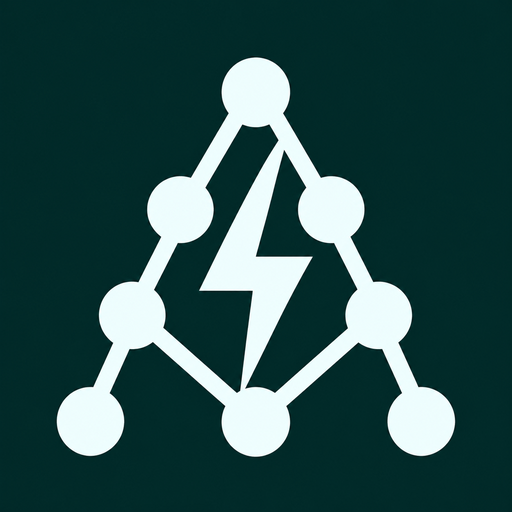
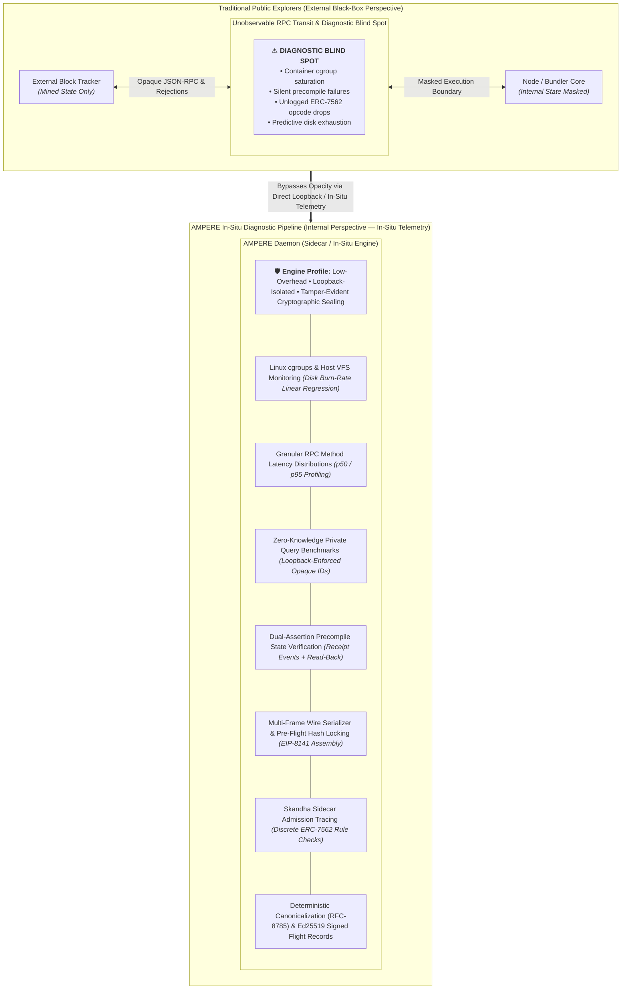
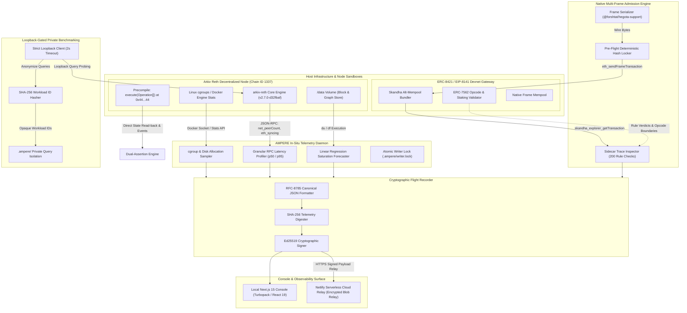
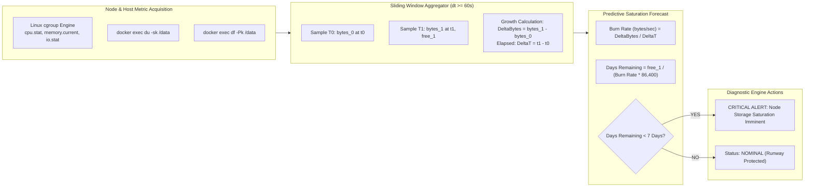
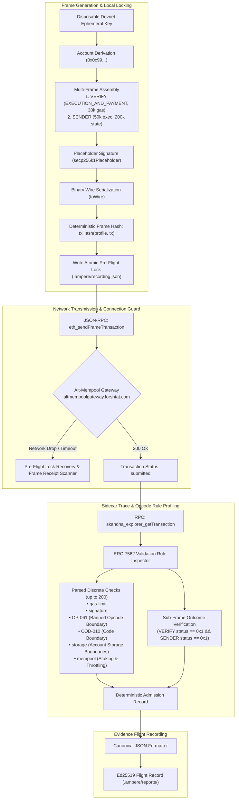
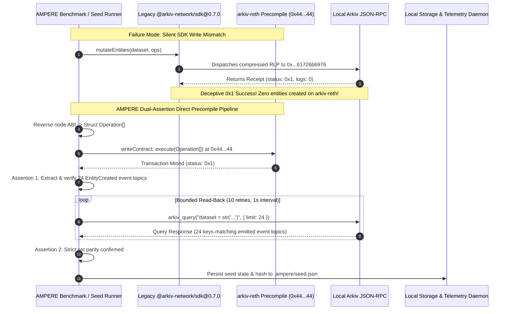
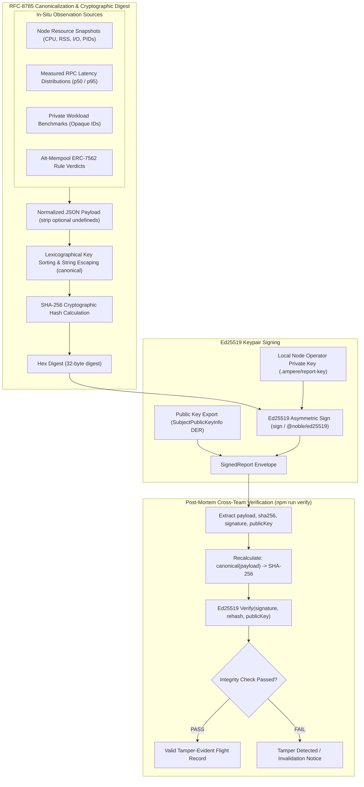

<p align="center">
  
</p>

<h1 align="center">AMPERE</h1>

<p align="center">
  <strong>High-Performance Infrastructure Flight Recorder & Admission Diagnostic Engine</strong><br />
  <em>In-Situ Node Telemetry · Predictive Storage Forecasting · EIP-8141 Multi-Frame Admission · ERC-8421 Alt-Mempool Rule Tracing</em>
</p>

<p align="center">
  <a href="#system-architecture"></a>
  <a href="#quickstart--boot-sequence"></a>
  <a href="#frontier-2-native-frame-transaction-admission--trace-diagnostics"></a>
  <a href="#cryptographic-flight-recorder-specification"></a>
  <a href="LICENSE"></a>
</p>

<p align="center">
  <a href="#system-architecture">Architecture</a> ·
  <a href="#frontier-1-in-situ-node-telemetry--predictive-capacity-management">Node Telemetry</a> ·
  <a href="#frontier-2-native-frame-transaction-admission--trace-diagnostics">Frame Admission</a> ·
  <a href="#engineering-breakthroughs--implementation-details">Breakthroughs</a> ·
  <a href="#quickstart--boot-sequence">Quickstart</a> ·
  <a href="#evidence-format--verification">Evidence Spec</a> ·
  <a href="docs/REQUIREMENTS.md">Audit Matrix</a> ·
  <a href="docs/RUNBOOK.md">Runbook</a>
</p>

---

## Executive Summary & System Overview

**AMPERE** is an open-source infrastructure flight recorder and admission diagnostic engine engineered for high-performance decentralized database nodes and next-generation native account abstraction mempools.

As the Ethereum ecosystem evolves, infrastructure complexity compounds at two critical, unobservable boundaries:
1. **Specialized Decentralized Storage Networks**: Nodes managing complex relational, vector, and graph state (such as [Arkiv Network](https://arkiv.network) running `arkiv-reth`) operate with atypical execution patterns, custom precompile layers, and aggressive state growth that standard Ethereum telemetry tools cannot inspect.
2. **Alternative Account Abstraction Mempools**: With the introduction of **EIP-8141** (Native Account Abstraction) and **ERC-8421** (Multi-Frame Alternative Mempools), transaction verification is decoupled from standard EVM execution wrappers into autonomous, sequential frames (`VERIFY`, `SENDER`, `PAYMASTER`) strictly governed by **ERC-7562** opcode boundary and staking validation rules.

### The Observability Divide



Public block explorers only observe the blockchain from the outside after blocks are finalized. They treat transaction drops, bundler rejections, host container saturation, and RPC degradation as opaque black boxes. 

AMPERE bridges this divide by deploying directly alongside node instances and bundler gateways, capturing low-level system metrics, tracing granular transaction admission verdicts, and sealing all diagnostic records into tamper-evident, cryptographically signed flight logs.

---

## System Architecture

AMPERE operates as a zero-hosted-database diagnostic engine comprising a local daemon collector, an isolated CLI benchmark harness, and a local Next.js 15 (App Router, React 19) diagnostic console styled with Tailwind CSS. It supports optional zero-trust serverless deployment on Netlify.

### End-to-End Architectural Data Plane



---

## Frontier 1: In-Situ Node Telemetry & Predictive Capacity Management

AMPERE runs directly alongside an `arkiv-reth` node instance pinned by digest in [compose.yaml](compose.yaml) running on chain ID 1337. It directly queries the local Docker socket, Linux cgroups, and the loopback JSON-RPC endpoint to extract high-fidelity telemetry that external observers cannot see.

### 1. Predictive Storage Saturation Forecasting

Database nodes running high-frequency state updates risk abrupt silent crashes when shared host storage fills up. AMPERE samples the node's `/data` directory through low-overhead container probes (`du -sk /data` and `df -Pk /data`) and calculates sliding linear disk consumption rates:

$$\text{BurnRate} = \frac{\Delta\text{Bytes}}{\Delta t} = \frac{\text{bytes}_1 - \text{bytes}_0}{t_1 - t_0} \quad (\text{bytes/second})$$

$$\text{DaysRemaining} = \frac{\text{FreeBytes}_{\text{current}}}{\text{BurnRate} \times 86,400}$$



- **Guard Windows**: Forecasts require a minimum 60-second observation window ($\Delta t \ge 60{,}000\text{ ms}$) and positive monotonic growth ($\Delta\text{Bytes} > 0$).
- **Autonomous Alerting**: When $\text{DaysRemaining} < 7$, AMPERE fires an urgent capacity alarm across the console and telemetry feed.

### 2. Granular RPC Method Profiling

AMPERE wraps calls in bounded microsecond-accurate probes (`src/lib/rpc.ts`), logging exact wall-clock durations, payload response sizes, and HTTP/RPC protocol codes:
- **Percentile Distributions**: Computes true $p_{50}$ (median) and $p_{95}$ latency distributions across monitored node methods (`net_peerCount`, `eth_syncing`, `arkiv_getEntityCount`, `arkiv_query`).
- **Failure Isolation**: Transport timeouts, JSON-RPC protocol error codes, and malformed responses are isolated from successful latency distributions to ensure mathematical purity of percentile statistics.
- **Latency Elevation Multipliers**: Flags regression whenever recent moving windows deviate by $\ge 3\times$ relative to established method baselines.

### 3. Private Workload Benchmarking with Zero Query Leakage

Node operators must benchmark query latency under stress without leaking proprietary database schemas, private entity keys, or potential denial-of-service query patterns to public monitoring dashboards.

AMPERE's benchmark harness enforces strict zero-knowledge isolation:
1. **Loopback Gate**: Strictly binds to loopback (`127.0.0.1` or `localhost`); rejects public IPs, domain names with DNS rebinding risks, and HTTP redirects.
2. **Deterministic Opaque Hashing**: Query strings are digested via SHA-256 and mapped into opaque IDs (`workload:0`, `workload:1`) in `.ampere/`.
3. **Disclosure Boundary**: Public reports and telemetry snapshots expose *only* opaque workload IDs and normalized latency percentiles. Raw query text never leaves the local disk.
4. **Execution Boundaries**: Max 4 workloads, 10 sequential samples each, bounded concurrency ($C=1$), and strict 2,000ms timeouts per query.

### 4. Dual-Assertion Precompile State Verification

Rather than trusting transaction status receipts alone, AMPERE implements an end-to-end dual-assertion validation harness against Arkiv's native state precompile:
1. **Receipt Event Extraction**: Encodes operations into `execute(Operation[])` at precompile address `0x4400000000000000000000000000000000000044` via Viem, parses receipt transaction logs, and extracts all `EntityCreated` indexed topics.
2. **Immediate Read-Back Assertion**: Executes bounded polling queries (`arkiv_query`) matching the dataset identifier, asserting that all 24 keys exist in state and strictly mirror the emitted event log set.

---

## Frontier 2: Native Frame Transaction Admission & Trace Diagnostics

Traditional Account Abstraction (ERC-4337) wraps user operations into complex contract wallets via an external EntryPoint. In contrast, **EIP-8141** integrates account abstraction directly into the Ethereum protocol execution model by organizing transactions into autonomous, ordered execution frames.

```text
EIP-8141 Multi-Frame Wire Structure:
┌────────────────────────────────────────────────────────────────────────┐
│ Native Frame Transaction Envelope                                      │
├────────────────────────────────────────────────────────────────────────┤
│ Frame 0: VERIFY Frame                                                  │
│  ├── Scope: EXECUTION_AND_PAYMENT                                      │
│  ├── Target: null (Sender Verification)                                │
│  └── Execution Gas Allocation: 30,000 gas                              │
├────────────────────────────────────────────────────────────────────────┤
│ Frame 1: SENDER Frame                                                  │
│  ├── Scope: Standard Execution Scope                                   │
│  ├── Target: 0x0c99FE76869e0e86E4d43A72cC244aA09f2B9910               │
│  ├── Execution Gas Allocation: 50,000 gas                              │
│  ├── State Gas Allocation: 200,000 gas                                 │
│  └── Value: 0 wei (Self-Transfer Probe)                                │
├────────────────────────────────────────────────────────────────────────┤
│ Signatures: secp256k1Placeholder                                       │
│ Gas Parameters: maxFeePerGas: 2,000,000,000 wei                        │
└────────────────────────────────────────────────────────────────────────┘
```

Frame transactions navigating **ERC-8421** alternative mempools are evaluated by bundlers (such as Skandha) against stringent **ERC-7562** validation rules. If a frame invokes an unauthorized opcode (e.g. `TIMESTAMP`, `BLOCKHASH`) or touches out-of-scope storage slots during the verification phase, the bundler silently drops the transaction.



### Frame Admission Diagnostic Pipeline:
1. **Frame Construction & Wire Encoding**: Constructs typed multi-frame payloads using `@forshtat/hegota-support/profiles` under the `ethrex-eip8141-tracer` profile, applying `toWire` serialization.
2. **Pre-Flight Hash Locking**: Derives the exact deterministic hash $H = \text{txHash}(\text{profile}, \text{tx})$ and writes an atomic lock to disk *before* dispatching bytes over the wire. If the remote bundler gateway abruptly terminates the connection, AMPERE recovers without risk of nonce collisions or duplicate submissions.
3. **Sidecar Rule Tracing**: Submits transactions via `eth_sendFrameTransaction` to the Skandha gateway (`https://altmempoolgateway.forshtat.com/rpc`, chain 1337). Interrogates `skandha_explorer_getTransaction` to parse up to 200 discrete validation checks:
   - **Opcode Boundaries**: Checks for forbidden EVM opcodes (e.g. `OP-061`, `COD-010`).
   - **Storage Boundaries**: Enforces strict account access lists.
   - **Staking & Reputation**: Validates sender/paymaster stake limits under ERC-7562 rules.
4. **Sub-Frame Execution Inspection**: Checks `frameReceipts` within the mined transaction receipt to verify whether `VERIFY` and `SENDER` frames succeeded independently (`0x1`).

---

## Engineering Breakthroughs & Implementation Details

### 1. Uncovering the Silent SDK/Node Write Mismatch

During early integration with Arkiv Network, writes dispatched using `@arkiv-network/sdk@0.7.0` (`mutateEntities`) returned deceptive transaction receipts:
- **Receipt Status**: `0x1` (Success).
- **Emitted Event Logs**: `0` logs.
- **Created Entities**: `0` entities written to state.



**Root Cause**: The published `@arkiv-network/sdk` sent compressed RLP payloads to address `0x000000000000000000000000000000000061726b6976`. However, the compiled `arkiv-reth` node binary handles mutations through a dedicated precompile at:
$$\texttt{0x4400000000000000000000000000000000000044}$$
with signature `execute((uint8,bytes,bytes)[])`.

**Engineering Solution**: We bypassed the SDK entirely, reversed the node's native precompile ABI (`src/lib/arkiv-abi.ts`), and implemented direct contract invocations with Viem. We instituted a **Dual-Assertion Verifier**: transactions are marked valid *only* if receipt event logs confirm emission of `EntityCreated` AND subsequent state read-backs confirm full key set parity.

### 2. Pre-Flight Hash Locking & Sub-Frame Receipt Recovery

Experimental devnet bundlers frequently drop TCP connections or return gateway timeouts under heavy load. In standard web3 clients, retrying leads to nonce errors or duplicate spend hazards.

AMPERE resolves this with an **Atomic Pre-Flight Lock**:
1. Computes the deterministic frame hash locally:
   $$\text{Hash} = \text{txHash}(\text{profile}, \text{tx})$$
2. Writes an atomic disk lock setting status to `unknown` and saves `.ampere/recording.json`.
3. If the RPC connection drops, `npm run ethereum:inspect` is invoked:
   - Polls `eth_getTransactionReceipt` using the locally preserved hash.
   - Parses the proprietary `frameReceipts` array to determine if sub-frames reverted individually.
   - Queries `skandha_explorer_getTransaction` to retrieve the bundler's sidecar execution trace.

### 3. Loopback Isolation & Zero Query Text Disclosure

Database queries often contain proprietary operational parameters or exploit payloads that identify node bottlenecks. AMPERE ensures strict operational security:
- Benchmark calls reject non-loopback addresses and HTTP redirects.
- In-flight queries are immediately digested via SHA-256 into opaque workload tags (`workload:0`).
- The diagnostic console, API routes, and exported signed reports retain *only* execution statistics and opaque IDs. Raw query texts remain strictly confined to the ignored `.ampere/` folder.

---

## Cryptographic Flight Recorder Specification

AMPERE normalizes all telemetry observations, RPC latency percentiles, and mempool rule verdicts into deterministic canonical JSON, digests the result with SHA-256, and signs the digest with Ed25519 (via `@noble/ed25519` / Node.js `crypto`).



### Deterministic Canonicalization Algorithm (RFC-8785 Compatible)

```typescript
export function canonical(value: unknown): string {
  if (value === null || typeof value === "boolean" || typeof value === "string")
    return JSON.stringify(value);
  if (typeof value === "number" && Number.isFinite(value))
    return JSON.stringify(value);
  if (Array.isArray(value)) 
    return `[${value.map(canonical).join(",")}]`;
  if (typeof value === "object" && value !== null) {
    const sortedKeys = Object.keys(value).sort();
    return `{${sortedKeys
      .map((k) => `${JSON.stringify(k)}:${canonical((value as Record<string, unknown>)[k])}`)
      .join(",")}}`;
  }
  throw new Error("Report contains a non-JSON value");
}
```

### Flight Record Envelope Schema (`ampere.report.v1`)

```json
{
  "payload": {
    "schema": "ampere.report.v1",
    "createdAt": "2026-11-07T02:27:00.000Z",
    "recording": {
      "updatedAt": "2026-11-07T02:27:00.000Z",
      "observations": [
        {
          "network": "arkiv",
          "method": "arkiv_query",
          "source": "probe",
          "durationMs": 42.15,
          "responseBytes": 1024,
          "outcome": "ok",
          "recordedAt": "2026-11-07T02:26:55.000Z"
        }
      ],
      "container": {
        "name": "ampere-arkiv-1",
        "cpuPercent": 4.12,
        "memory": "256MiB / 16GiB",
        "blockIO": "12MB / 45MB",
        "pids": 38,
        "dataBytes": 104857600,
        "filesystemFreeBytes": 42949672960,
        "diskDaysRemaining": 48.2
      },
      "transaction": {
        "hash": "0x927af9b0fa245d12814d117ea583ce3713af894a2878557ab70456038658daf8",
        "status": "included",
        "explorer": "https://explorer.altmempool.wtf/"
      },
      "admission": {
        "hash": "0x927af9b0fa245d12814d117ea583ce3713af894a2878557ab70456038658daf8",
        "outcome": "admitted",
        "checks": [
          { "rule": "gas-limit", "verdict": "passed" },
          { "rule": "OP-061", "verdict": "passed" },
          { "rule": "storage", "verdict": "passed" }
        ],
        "events": [
          { "kind": "received", "status": "ok", "at": 1730946420000 },
          { "kind": "validated", "status": "ok", "at": 1730946420120 }
        ]
      }
    },
    "limitations": [
      "Client wall-clock latency is not server CPU cost.",
      "An embedded signing key does not establish operator identity.",
      "Integrity does not establish measurement truth.",
      "Fixture recordings are synthetic, never live network evidence."
    ]
  },
  "sha256": "5f4dcc3b5aa765d61d8327deb882cf99...",
  "signature": "3045022100...",
  "publicKey": "-----BEGIN PUBLIC KEY-----\nMCowBQYDK2VwAyEA...\n-----END PUBLIC KEY-----"
}
```

---

## Quickstart & Boot Sequence

### Prerequisites
- **Node.js**: $\ge \text{v22.16.0}$
- **Docker Engine**: Running Linux container engine (Docker Desktop or Linux daemon)
- **Host OS**: Linux, macOS, or Windows (WSL2 / PowerShell / Git Bash)
- **Ports**: `8545` (Arkiv node RPC), `3000` (AMPERE web console)

### 1. Initialize Stack & Start Arkiv Node

```bash
# Clone and install dependencies
git clone https://github.com/your-org/ampere.git
cd ampere
npm ci

# Launch pinned arkiv-reth node container in background
docker compose up -d

# Execute diagnostic pre-flight environment check
npm run doctor
```

`npm run doctor` validates:
- Docker daemon reachability and container status.
- Arkiv JSON-RPC loopback responsiveness (`http://127.0.0.1:8545`, Chain ID 1337).
- Ethereum alternative mempool gateway accessibility (`https://altmempoolgateway.forshtat.com/rpc`).
- Local filesystem locks and recording store integrity.

### 2. Launch Telemetry Collector & Console

In Terminal 1 (Start continuous in-situ sampling):
```bash
npm run collect:watch
```
*The collector polls container cgroups, disk usage, and node RPC endpoints every 10 seconds.*

In Terminal 2 (Start Next.js diagnostic console):
```bash
npm run dev
```
Open **`http://127.0.0.1:3000`** to view real-time latency distributions, container resource gauges, disk capacity forecasts, and transaction admission traces.

---

## Protocol Diagnostic Workflows

### 1. Arkiv State Seeding & Workload Benchmarking

```bash
# Seed 24 distinct entities via direct precompile execution
# Enforces dual-assertion: checks receipt logs AND read-back parity
npm run arkiv:seed

# Execute loopback-isolated private query benchmark
# Runs 2 workloads × 10 sequential iterations under bounded concurrency
npm run arkiv:benchmark

# Test fixed-block retention and historical state boundaries (-32006 test)
npm run arkiv:benchmark:fixed
```

#### Node Environment Identity:
| Parameter | Configuration | Notes |
| :--- | :--- | :--- |
| **Node Client** | `arkiv-reth --dev` | Reports version `reth/v2.7.0-d32fbaf` |
| **Chain ID** | `1337` | Local development chain |
| **RPC Interface** | `http://127.0.0.1:8545` | Bound exclusively to loopback |
| **Container Image** | `ghcr.io/arkiv-network/arkiv-reth` | Pinned by digest in [compose.yaml](compose.yaml) |
| **Precompile Target** | `0x4400000000000000000000000000000000000044` | Interface `execute(Operation[])` |
| **Entity Schema** | Indexed key, dataset, owner, expiry | Detailed in [arkiv/schema.md](arkiv/schema.md) |

### 2. EIP-8141 Native Frame Transaction Admission

```bash
# Construct, sign, lock, and submit an EIP-8141 multi-frame transaction
npm run ethereum:send

# To opt-in to automatic workshop devnet faucet funding:
npm run ethereum:send:faucet

# Interrogate Skandha bundler sidecar for ERC-7562 rule traces
npm run ethereum:inspect
```

#### Devnet & Admission Validation Record:
- **Alt-Mempool Gateway**: `https://altmempoolgateway.forshtat.com/rpc` (Chain ID 1337)
- **Devnet Sender Account**: `0x0c99FE76869e0e86E4d43A72cC244aA09f2B9910`
- **Submitted Devnet Frame Tx**: [`0x927af9b0fa245d12814d117ea583ce3713af894a2878557ab70456038658daf8`](https://explorer.altmempool.wtf/tx/0x927af9b0fa245d12814d117ea583ce3713af894a2878557ab70456038658daf8)
- **Captured Rule Verdicts**: 17 discrete ERC-7562 validation checks (`gas-limit`, `signature`, `OP-061`, `COD-010`, `storage`, `mempool`) parsed and verified live.

---

## Evidence Format & Verification

### Exporting & Verifying Flight Records

From the AMPERE web console, navigate to **Reports** and click **Export Signed Flight Record**. The payload can be verified independently via the CLI verification harness:

```bash
npm run verify -- path/to/signed-report.json
```

The verification engine:
1. Reconstructs the canonical JSON string from `payload` according to RFC-8785.
2. Computes the raw SHA-256 hash.
3. Asserts equality between calculated hash and envelope `sha256`.
4. Validates the Ed25519 signature against the embedded `publicKey`.

```bash
# Example verification output:
$ npm run verify -- .ampere/reports/report-1730946420.json
[AMPERE] Canonicalizing payload (4,218 bytes)...
[AMPERE] SHA-256 Digest: 5f4dcc3b5aa765d61d8327deb882cf99...
[AMPERE] Signature: Ed25519 verified successfully.
[AMPERE] Audit Verdict: VALID TAMPER-EVIDENT FLIGHT RECORD.
```

---

## Netlify Serverless Cloud Relay

AMPERE is configured for seamless zero-port deployment on [Netlify](https://www.netlify.com):
- **Local Telemetry Stays Private**: Docker and the collector daemon stay on your local workstation or private VPC.
- **Outbound Authenticated Relay**: The daemon securely pushes signed telemetry snapshots over HTTPS to Netlify via `/api/ingest`.
- **Zero Inbound Attack Surface**: No public node RPC ports or reverse tunnels (e.g. ngrok) required.
- **Netlify Blobs**: Uses Netlify Blobs for encrypted persistent snapshot storage.

See the complete configuration walkthrough in the [Netlify Deployment Guide](docs/NETLIFY.md).

---

## Codebase Map

```text
ampere/
├── compose.yaml                # Arkiv Reth node pinned by immutable digest
├── netlify.toml                # Netlify build and edge deployment rules
├── package.json                # Next.js 15, Viem, Hegota, Ed25519 dependencies
├── src/
│   ├── lib/
│   │   ├── admission.ts        # Skandha ERC-7562 rule trace & lifecycle parser
│   │   ├── analysis.ts         # p50/p95 latency percentiles & linear disk forecast
│   │   ├── arkiv-abi.ts        # Direct precompile ABI & seed operation generator
│   │   ├── collector.ts        # Periodic RPC & host cgroup telemetry aggregator
│   │   ├── container.ts        # Docker stats & du/df filesystem execution engine
│   │   ├── frame-transaction.ts# EIP-8141 multi-frame assembler & receipt verifier
│   │   ├── recorded-call.ts    # Transparent RPC execution & timing wrapper
│   │   ├── recording-schema.ts # Runtime zod-like payload validation rules
│   │   ├── report.ts           # RFC-8785 canonicalizer, SHA-256, Ed25519 signer
│   │   ├── rpc.ts              # Loopback-enforced HTTP transport & code classifier
│   │   ├── store.ts            # Atomic snapshot persistence & backup manager
│   │   ├── types.ts            # Comprehensive TypeScript diagnostic domain types
│   │   └── writer.ts           # Exclusive process file-locking coordinator
│   └── components/             # Next.js 15 UI diagnostic panels & timeline
├── scripts/
│   ├── collect.ts              # Headless node & host telemetry collector
│   ├── doctor.ts               # Environment diagnostic & sanity verification
│   ├── inspect-frame.ts        # EIP-8141 transaction & admission inspector
│   ├── seed-arkiv.ts           # 24-entity dual-assertion precompile seeder
│   ├── send-frame.ts           # EIP-8141 frame transaction submission & lock
│   ├── benchmark-arkiv.ts      # Zero-leakage private query latency harness
│   └── verify-report.ts        # Standalone Ed25519 report verification CLI
└── docs/
    ├── REQUIREMENTS.md         # Formal track evaluation & audit requirements
    ├── RUNBOOK.md              # Detailed operator troubleshooting procedures
    ├── VALIDATION.md           # Live devnet submission evidence & test proofs
    ├── NETLIFY.md              # Serverless Netlify relay setup instructions
    └── assets/                 # Architecture maps, banners, and brand vectors
```

---

## Comprehensive Validation Matrix

AMPERE enforces full automated test validation across all subsystems:

```bash
# Run typechecking, unit tests, and production bundle privacy verification
npm run check

# Run Playwright browser end-to-end test suite
npm run test:e2e
```

### Automated Test Suite Overview (18/18 Passing):

| Test Suite | Subsystem Validated | Result |
| :--- | :--- | :---: |
| **`tests/arkiv-benchmark.test.ts`** | Error handling, loopback isolation, zero query text disclosure | **PASS** |
| **`tests/container.test.ts`** | Linear regression saturation model, runway alerts (<7d) | **PASS** |
| **`tests/frame-transaction.test.ts`** | Multi-frame receipt status, sub-frame revert detection | **PASS** |
| **`tests/admission.test.ts`** | ERC-7562 rule extraction, opcode boundary parsing | **PASS** |
| **`tests/report.test.ts`** | RFC-8785 canonicalization, Ed25519 signature tamper rejection | **PASS** |
| **`tests/rpc.test.ts`** | Timeout deadlines, redirect rejection, code classification | **PASS** |
| **`tests/writer.test.ts`** | Mutual exclusion locks (`writer.lock`), process crash cleanup | **PASS** |
| **`tests/storage.test.ts`** | Snapshot bounds (1,000 observations), corruption handling | **PASS** |
| **`tests/relay.test.ts`** | Netlify Blobs authenticated ingest & origin enforcement | **PASS** |
| **`scripts/check-bundle.ts`** | Bundle privacy check: asserts zero leakage of keys or queries | **PASS** |

---

## Failure Recovery & Operator Troubleshooting

| Observed Symptom | Underlying Root Cause | Remediation Procedure |
| :--- | :--- | :--- |
| **Node RPC Connection Refused** | Container stopped or starting up | Run `docker compose ps` followed by `docker compose logs --tail 30`. Verify port `8545` is not conflicting. |
| **Stale Dashboard Recording** | Collector watch process inactive | Run `npm run collect:watch` in a dedicated background shell. |
| **Active Writer Lock Conflict** | Previous writer crashed unexpectedly | Verify no other script is running; safely remove `.ampere/writer.lock`. |
| **Historical Query Error `-32006`** | Arkiv state retention pruning | State at requested block was pruned. Run `npm run arkiv:benchmark` (moving-head mode). See [friction notes](arkiv/friction.md). |
| **Missing Container Resource Gauges** | Docker engine stats unresponsive | Verify Docker engine is running; ensure `ARKIV_CONTAINER=ampere-arkiv-1` matches the active container. |
| **Devnet Transaction Unresolved** | Gateway timeout / connection drop | Run `npm run ethereum:inspect`. The pre-flight lock preserves the transaction hash for atomic recovery. |
| **Faucet Returns "Faucet is empty"** | Devnet faucet reserves depleted | Request workshop testnet funds or fund `0x0c99FE76869e0e86E4d43A72cC244aA09f2B9910` manually on chain 1337. |

---

## Provenance & License

- **License**: Released under the open-source [MIT License](LICENSE).
- **Core Integrations**: Built against Arkiv Network (`arkiv-reth`), Forshtat Hegota (`@forshtat/hegota-support`), Skandha Bundler Gateway, Viem, and Netlify Blobs.
- **Attribution & Sources**: Upstream dependencies, precompile specifications, and research profiles are cataloged in [SOURCES.md](docs/SOURCES.md).
