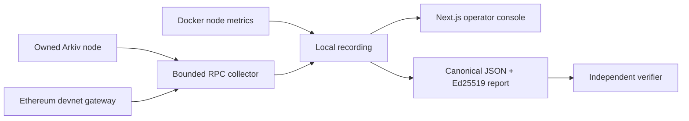

# AMPERE operator runbook

A flight recorder for blockchain infrastructure. Record requests, compare their
latency, inspect node resources, and export signed evidence.

Built for **ETHGlobal Mumbai 2026**, targeting **Ethereum Foundation: Frame
Transaction Alternative Mempool** and **Arkiv: Node tooling**. Track fit is based
on the [official requirements](https://ethglobal.com/events/mumbai/prizes).
Lower submission volume is a strategy hypothesis, not a verified count.

## Run locally

Requirements: Node.js 22.16+, npm, and Docker Desktop with its Linux engine running.
The dashboard and node bind to loopback. Google Chrome is needed for browser tests.

```sh
npm ci
docker compose up -d
npm run collect
npm run dev
```

Open **http://127.0.0.1:3000**. In another terminal, use `npm run collect:watch`
for periodic collection. The UI refreshes the saved recording every five seconds;
the collector completes a sampling cycle, then waits ten seconds. It must be
running for fresh measurements. The Example switch is explicitly synthetic.

Configuration is optional: copy `.env.example` to `.env.local`. Arkiv endpoints
must be literal loopback HTTP addresses. Container resource sampling expects the
Compose container `ampere-arkiv-1`; override `ARKIV_CONTAINER` if needed.

## Working Arkiv demo

Stop the watch collector before running commands that write a recording.

```sh
npm run arkiv:seed
npm run arkiv:benchmark
npm run collect:watch
```

The seed command creates 24 entities, checks 24 creation events, and reads all 24
back. It uses the pinned node's entity-registry ABI through viem. The published
SDK 0.7 write API is incompatible with this node revision; see
[the measured integration feedback](../arkiv/friction.md).

The benchmark performs ten samples for each of two ordinary equality lookups.
It is sequential, limits pages to ten entities, uses a two-second request timeout,
and stops on the first failure or latency over one second. User-supplied case files
are limited to four cases, so a run can never exceed 40 query requests.

Inputs and query-to-workload mappings stay in ignored `.ampere/*.private.json`
and `.ampere/benchmark-cases.json`. Public observations use random workload IDs,
not query text or query hashes. Do not share these private files in the public
repository or demo. Share any discovered slow-query shape privately with Arkiv.

Default benchmarks read a moving chain head and record each returned block.
`npm run arkiv:benchmark:fixed` requests one fixed block; it may stop
with `-32006` on this node build. This is documented feedback, not an expensive
query finding. A moving-head comparison can be affected by changing chain state.

Node used: `ghcr.io/arkiv-network/arkiv-reth`, pinned in `compose.yaml` to digest
`sha256:83d58d3d79c7d1a3e3b95cc94f2d9baa37cb2801d1cda6753727de46a8688a31`.
Single-node `--dev`, chain 1337. Its client reports
`reth/v2.7.0-d32fbaf/x86_64-unknown-linux-gnu`. This is an owned local development
node, not the Arkiv public testnet. CPU/memory come from Docker stats; data size
comes from `/data`; free capacity is shared by the Docker filesystem. Host-wide
metrics are labeled separately. Forecasts require at least 60 seconds of growth
history in one collector process and alert below seven estimated days.

The seed writer is the **public development account**
`0xf39Fd6e51aad88F6F4ce6aB8827279cffFb92266`; its well-known key is intentionally
used only on a loopback dev chain. Entity schema is in [arkiv/schema.md](../arkiv/schema.md).
Current seed keys, dataset ID and transaction hash are in `.ampere/seed.json`.

## Ethereum devnet submission

The default gateway is `https://altmempoolgateway.forshtat.com/rpc`, chain **1337**.
This is an experimental EIP-8141 devnet; Sepolia and mainnet cannot run this flow.

```sh
npm run ethereum:send
npm run ethereum:inspect
```

The sender checks chain ID, generates/reuses an ignored disposable key, requires
at least 0.001 workshop devnet ETH, builds and signs a zero-value self-transfer with VERIFY
and SENDER frames, submits `eth_sendFrameTransaction`, and checks its receipt.
The inspector captures the sidecar's rule verdicts and lifecycle events using
`skandha_explorer_getTransaction`. Both commands record measured RPC exchanges.
Inspect another transaction with `npm run ethereum:inspect -- 0x<hash>`.

Faucet requests are opt-in through `npm run ethereum:send:faucet`. The normal
sender prints its address and stops if unfunded. The local transaction hash is
saved before submission; an RPC rejection records `rejected`, and a transport
failure leaves `unknown`. Inspect before retrying an unresolved submission.
Inspection reads the receipt separately from sidecar history so inclusion can
still be recovered after sidecar records expire. No automatic resubmission runs.

**Current dependency:** the gateway's faucet returned `The faucet is empty` on
2026-11-06. The account awaiting devnet funding is
`0x0c99FE76869e0e86E4d43A72cC244aA09f2B9910`. No admitted AMPERE frame transaction
is claimed yet. Fund it on the workshop devnet, then rerun the two commands.
Find it at [the explorer](https://explorer.altmempool.wtf/) by searching its hash.

## Reports and measurement semantics

- Reports contain the complete retained recording (up to 1,000 requests), not
  just the filtered dashboard view. Export uses the latest saved snapshot.
- SHA-256 hashes canonical JSON with sorted object keys. Ed25519 signs the same
  canonical bytes. The signing key stays in `.ampere/report-key.pem`.
- Use Reports → Choose report, or `npm run verify -- path/to/report.json`.
- An embedded public key verifies integrity, not trusted operator identity.
  No blockchain anchoring or trusted timestamp is implemented.
- Latency is client wall-clock time, not isolated server CPU consumption.
  RPC errors, timeouts and transport failures are different outcomes.
- Method comparisons use the first five vs. last five successful samples within
  the retained window; ten are required. Query workloads have separate baselines.
  A 3× change is a heuristic to investigate, not proof of an attack.
- Node state and resource snapshots are point-in-time observations. This MVP is
  a local tool, not an authenticated multi-user hosted service.

## Validation

```sh
npm run check
npm run test:e2e
```

Core tests cover integrity/tampering, baseline separation, local-target rules,
timeouts, response bounds, malformed RPC responses, and admission redaction.
Browser tests exercise inspection, filtering, export, verification, tampering,
and mobile overflow. Live Arkiv seeding and benchmarking were also exercised.
See [docs/VALIDATION.md](VALIDATION.md) for the current evidence and gaps.
The combined check runs type checking, 18 tests and the production build; six
browser/API tests cover interaction and error recovery. Ethereum CLI integration
uses an isolated local RPC mock, not a funded devnet. CI runs the production
server with bundled Playwright Chromium; local tests use installed Chrome.

For normal production use: `npm run build`, `npm start`, then
`npm run collect:watch` in another terminal. Bindings remain on loopback.

For a hosted console, use the [Netlify guide](NETLIFY.md). Keep the collector and
Docker together and upload signed snapshots. The serverless app reads Blobs;
it does not try to read your laptop's filesystem or run Docker.

## Architecture



No raw query parameters or private keys enter a report. There is no hosted
database, analytics script, external font request, or automatic report upload.
Upstream sources are listed in [docs/SOURCES.md](SOURCES.md).

## Troubleshooting

- Start with `npm run doctor`. It checks the environment without writes or funding
  requests and exits nonzero when required local prerequisites fail.
- Node unavailable: run `docker compose ps` and `docker compose logs --tail 30`.
- Empty dashboard: run `npm run collect`; check `.ampere/recording.json`.
- Writer lock: stop the other recording command. After a confirmed crash, remove
  only `.ampere/writer.lock` before retrying. One writer is supported at a time.
  New locks record a PID and start time. Normal read/write failures release them;
  a forced process kill can still leave one behind. Never remove an active lock.
- Invalid recording: preserve `.ampere/recording.json` for diagnosis, then restore
  a valid backup. Unknown fields and malformed measurements are rejected before
  the console or report signer uses them. Example mode remains separate.
- Ethereum faucet unavailable: obtain workshop devnet funds from EF mentors.
- `-32006` in a fixed-block benchmark: see the retention issue in the feedback.
- Missing container metrics: confirm Docker is running and `ARKIV_CONTAINER`
  matches the node. Unavailable metrics are not replaced with host values.
- Stop the node without deleting data: `docker compose stop`.

## External gates and future extensions

External gates: funding and live Ethereum admission verification, public
repository publication, and the team's final submission demo. Publication and
funding are deferred at the owner's request.

Future extensions: per-frame gas and local ethrex trace profiling, deeper
controlled workload analysis, and third-party operator testing.
Hedera and Swarm are deferred. A polished UI alone does not complete either prize.

## AI disclosure

Developed with OpenAI Codex for research, implementation, testing and documentation.
The team must review the code and explain the measurements and trade-offs.
MIT licensed. This repository was initialized empty for the event.
